# Architecture

## Process model

A single unelevated .NET 8 WPF process owns the system tray, hidden hotkey message window, nonactivating popup, picker and settings. A per-session named mutex prevents duplicate instances. Startup is opt-in using the current user's Run registry key. A background MTA accessibility thread checks focused-field metadata every 120 ms; its result expires after 500 ms. Accessibility focus-change events invalidate the cached decision. A hung provider cannot block the hook: the snapshot expires. Disposal unregisters hooks, hotkeys, tray icon, timers and message window.

```mermaid
flowchart LR
  Keys[Win32 low-level hook] --> Guard[Cached field privacy decision]
  Guard --> Parser[Bounded shortcode parser]
  Parser --> Queue[Dispatcher work with revision check]
  Queue --> Search[Prefix and bigram index]
  Search --> Popup[Nonactivating suggestion window]
  Popup --> Confirm[Confirm and invalidate candidate]
  Confirm --> Verify[Async exact preceding-range verification]
  Verify --> Recheck[Focus, field, input generation and modifiers]
  Recheck --> Send[One SendInput batch]
  Send --> Store[Persist usage IDs and counts]
```

## Input state and cancellation

`KeyboardMonitor` installs WH_KEYBOARD_LL and WH_MOUSE_LL on the UI message thread. The callback never performs file I/O, HTTP, UI Automation calls, or text insertion. Search and popup construction are dispatched outside the callback and discarded when the parser revision has changed. Hiding the popup is also dispatched. Navigation keys adjust a cached result selection. Suppressed keydowns have matching suppressed keyups and repeats. Injected input is ignored in normal operation. Comet's own injected events carry a marker and are always ignored, including in opt-in test mode.

The parser retains only the trigger and up to 64 ASCII shortcode characters; it does not build a general keyboard history. Trigger recognition requires a tracked boundary. Enter/Tab confirms only while suggestions are current; Escape, navigation/cursor keys, mouse actions outside the popup, modifiers, foreground/focus/layout changes, accessibility runtime-ID changes, IME state, or timeout cancel the candidate. Backspace edits only the candidate. ToUnicodeEx with the non-state-changing flag translates the focused thread's layout. Dead keys/multiple-character translations are cancelled rather than guessed. Complex IME composition is unsupported.

The callback uses small Win32 state queries and parser operations; these have not been latency-profiled on Windows. There is no claim that all providers/layouts are supported.

## Safe replacement boundary

`ReplacementPlan` restricts deletion to the ASCII candidate that was tracked. `TextInsertionService` asynchronously checks UI Automation TextPattern for exactly one empty selection, clones its range, moves its start backward by the candidate length and compares that bounded text with the expected shortcut. It never requests an entire field value or document. Verification has a 400 ms timeout and permits at most one in-flight provider call. A provider call cannot be forcibly aborted, so an indefinitely hung verification disables subsequent replacements until the call returns or the app restarts.

Immediately before injection, the foreground window, GUI focus handle, fresh privacy decision, physical-input generation and modifiers are checked again. Changed typing/focus cancels rather than retrying. A shifted closing trigger gets up to 250 ms for modifiers to be released. Deletion and insertion are batched in one SendInput call. ASCII candidate characters map to one Backspace each. Output preserves UTF-16 surrogate pairs, ZWJs and variation selectors. Line breaks become Enter key events; this is appropriate only in multiline editors. Partial SendInput acceptance is reported and never automatically retried.

UI Automation and SendInput do not provide an atomic cross-process edit transaction. Focus/caret changes after final verification remain a narrow race. Applications may process, transform, or reject input differently. This limitation is explicit; no universal insertion guarantee is made.

Picker insertion restores the preceding editable application's foreground window, waits briefly for a fresh guard decision and released modifiers, and inserts without deletion. Copy is explicit or an opt-in post-insertion side effect. Default insertion does not touch the clipboard; arbitrary clipboard formats therefore need not be round-tripped or restored.

## Search and data

Metadata is embedded in `Comet.Core` and includes aliases, categories, name-derived keywords, tone and base IDs. Prefix and bigram indexes bound candidate lookup; ranking prefers exact aliases, prefixes, substring matches, one-edit fuzzy matches and short subsequences. Usage/favorites affect order. Custom expansions take precedence. Up to 256 query results are cached and invalidated on settings, usage, favorites, tone or expansion changes. The full dataset is enumerated for unfiltered category browsing, which is cached; live nonempty autocomplete does not repeatedly scan every emoji.

`SnippetExpander` resolves recognized date/time tokens at insertion time with local Windows culture/time. Unknown variables remain literal. It executes no scripts or commands. Arbitrary snippets are limited to 16,000 UTF-16 code units at configuration validation. Runtime expansion can lengthen them slightly.

Settings live at `%LOCALAPPDATA%\Comet\settings.json`, written through a flushed sibling temporary file then renamed over the destination. Imports are schema/range/duplicate validated and limited to 4 MB. Corrupt existing settings pause autocomplete and are not automatically overwritten; explicit Settings Save can replace them. Settings are local plaintext and can contain private snippets. Export does not embed managed GIF bytes; GIF paths are machine-local.

## UI and GIFs

The popup is WS_EX_NOACTIVATE/TOOLWINDOW, topmost, omitted from the taskbar and handles mouse activation with MA_NOACTIVATE. It anchors to the Win32 caret where available, otherwise the mouse, and clamps to the monitor work area. WPF and the manifest request per-monitor DPI awareness. Exact scaling across mixed-DPI displays is unverified. Theme follows a launch/settings-time system preference or explicit light/dark selection; open regular windows retain their existing theme, new windows use the selected theme.

The picker uses a keyboard-navigable wrapping list, search, categories, favorites, recents, frequency and skin-tone preferences. The GIF library imports user-selected local GIFs, previews animation with the Windows drawing decoder, searches local names and places a file-drop list on the clipboard. It contains no online search provider or proprietary GIF pack. Removal does not silently delete copied files.

## Deployment

Publish target is `win-x64`, self-contained, without trimming. The distribution contains the Windows apphost, .NET/WindowsDesktop runtime, embedded dataset, original icon and notices. Do not distribute only the EXE. The optional PowerShell installer is per-user and does not request elevation. No updater, telemetry backend, elevated helper, driver, TSF registration, browser extension or Windows service is installed.
